<p align="center">
  
</p>

<h1 align="center">PlayMentor 🧬</h1>

<p align="center"><b>An adaptive, gamified mobile learning app for Sri Lankan O/L Biology students.</b><br><i>Learn · Play · Grow</i></p>

PlayMentor turns exam revision into a game. Students answer curriculum-aligned multiple-choice questions, earn XP, keep streaks alive, unlock badges and climb a leaderboard. Behind the scenes, an adaptive learning engine adjusts question difficulty to each student's performance, topic by topic, and remembers where they left off.

Built with **Unity 6** and **Firebase** as the PUSL2021 Computing Group Project (Group 75) at NSBM Green University / University of Plymouth.


<p align="center">
  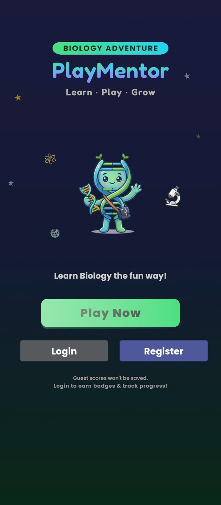
  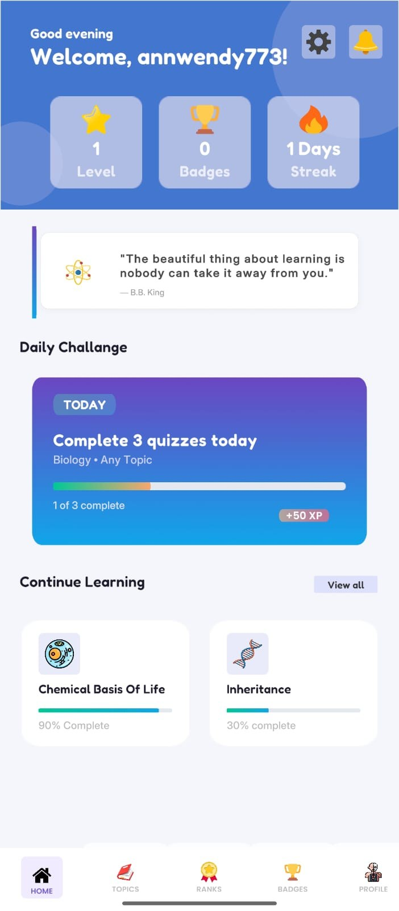
  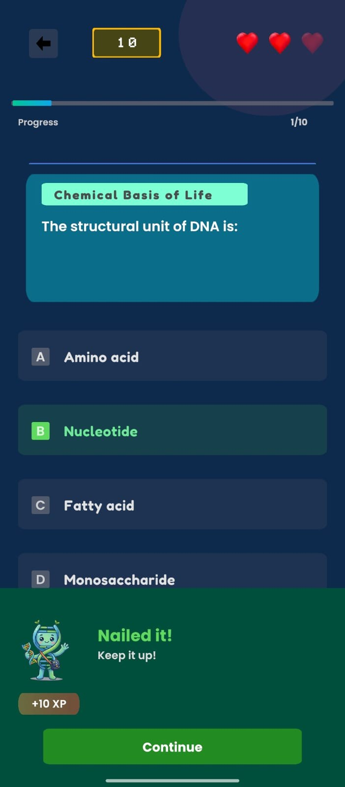
  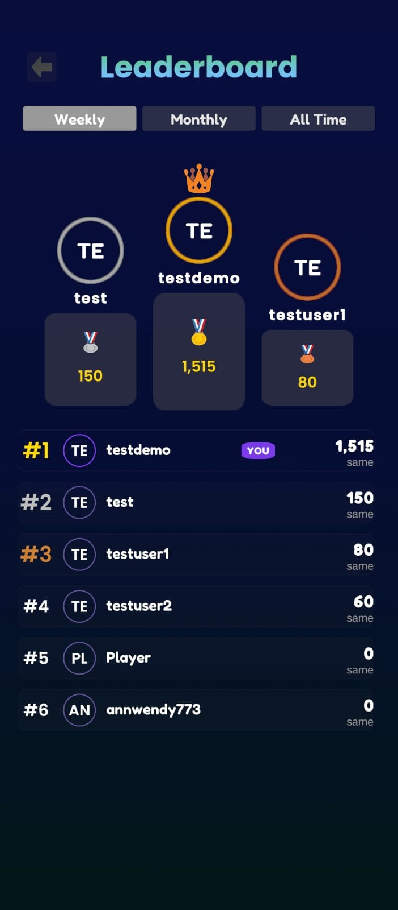
</p>

---

## 📱 Screenshots

<table>
  <tr>
    <td align="center"><br><b>Main menu</b><br><sub>Play as a guest or sign in</sub></td>
    <td align="center">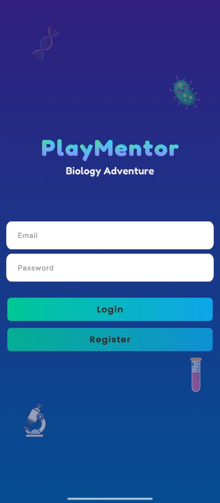<br><b>Login</b><br><sub>Firebase email/password</sub></td>
    <td align="center"><br><b>Dashboard</b><br><sub>Level, badges, streak, daily challenge</sub></td>
  </tr>
  <tr>
    <td align="center">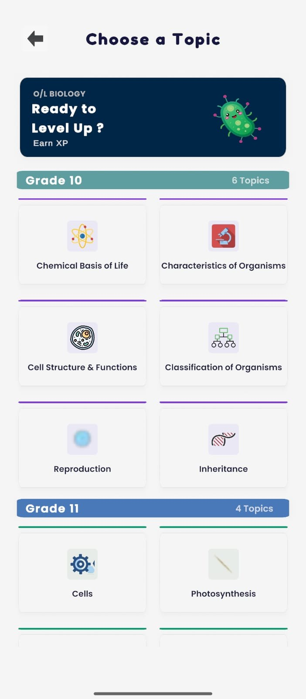<br><b>Choose a topic</b><br><sub>10 topics across Grades 10 & 11</sub></td>
    <td align="center">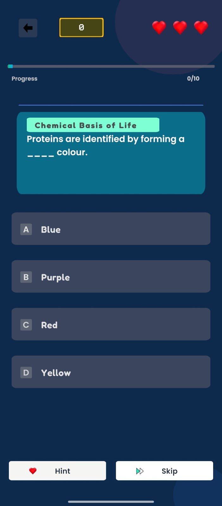<br><b>Quiz</b><br><sub>Lives, hints and skip</sub></td>
    <td align="center"><br><b>Instant feedback</b><br><sub>Correct answer + XP earned</sub></td>
  </tr>
  <tr>
    <td align="center"><br><b>Leaderboard</b><br><sub>Weekly, monthly, all-time</sub></td>
    <td align="center">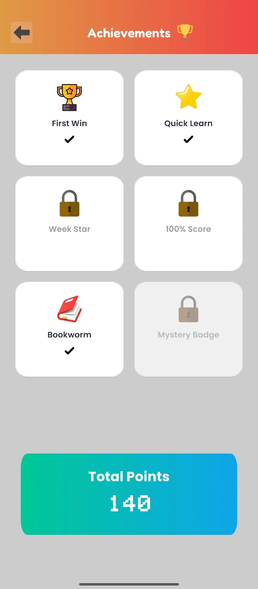<br><b>Achievements</b><br><sub>Unlockable badges</sub></td>
    <td align="center">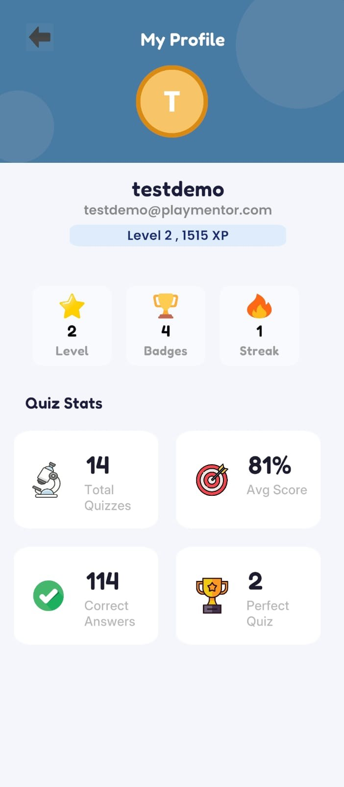<br><b>Profile</b><br><sub>Quiz stats and progress</sub></td>
  </tr>
</table>

---

## ✨ Features

### 🎯 Quiz engine
- 10 multiple-choice questions per session, filtered by topic and the player's current difficulty
- **3 lives** per session: a wrong or skipped answer costs a life
- **Hints** (up to 2 per session) that remove one wrong option
- **Skip** button, slide-up feedback panel showing the correct answer, XP earned and streak
- Game-over screen with correct, wrong and XP totals

### 🧠 Adaptive learning
- Every question is tagged **easy**, **medium** or **hard**
- New topics start at **medium**
- **3 correct in a row → difficulty goes up · 2 wrong in a row → difficulty goes down**
- Difficulty state is saved per topic to Firestore and restored next session
- If a difficulty pool has fewer than 10 questions, it's topped up from neighbouring levels and shuffled (Fisher-Yates)

### 🏆 Gamification
- **XP and levels**: 10 XP per correct answer, +5 bonus on a 3+ streak; `Level = floor(TotalXP / 1000) + 1`
- **Daily streak** counter
- **Achievement badges**: First Win, Quick Learn, Bookworm, 100% Score, Week Star and a hidden Mystery Badge
- **Leaderboard** with weekly, monthly and all-time views plus a podium
- **Daily challenges** that rotate and reset at midnight UTC

### 📊 Student dashboard
Username, level, XP, streak, badge count, recent topic progress bars, today's challenge and a daily motivational quote.

### 🔐 Accounts
- Email/password sign-up and login with Firebase Authentication
- Password reset by email
- **Guest mode**: play quizzes without an account (nothing is saved)

### 🎵 Polish
Background music with crossfades between scenes, sound effects, button animations, particle bursts and fade transitions. Sound and music preferences are saved locally.

---

## 📚 Content

**150 questions** across **10 O/L Biology topics** (15 per topic, Grades 10–11):

Chemical Basis of Life · Characteristics of Living Organisms · Cell Structure and Function · Classification · Reproduction · Inheritance · Cell Biology · Photosynthesis · Biological Processes · Biosphere

---

## 🏗️ Architecture

PlayMentor uses a **two-tier client–cloud architecture**. The Unity Android app talks directly to Firebase; there's no custom server.

```
┌────────────────────────────┐        HTTPS        ┌─────────────────────────────┐
│     Unity Android Client    │ ◄─────────────────► │        Firebase Cloud        │
│                             │   Firebase Unity    │                             │
│  Scenes + scene controllers │        SDK          │  • Authentication           │
│  Persistent singletons:     │                     │  • Cloud Firestore          │
│   FirebaseManager           │                     │  • Security Rules           │
│   AdaptiveLearningEngine    │                     │  • Storage (future media)   │
│   QuizDataManager           │                     │                             │
│   AchievementManager        │                     └─────────────────────────────┘
│   AudioManager              │
│   SceneTransitionManager    │
└────────────────────────────┘
```

Long-lived services are **singleton managers** created once and kept alive across scenes with `DontDestroyOnLoad`. Scene-specific UI lives in scene-local controllers.

<p align="center">
  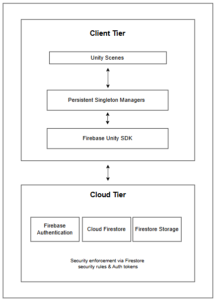
</p>

### Quiz session flow

<p align="center">
  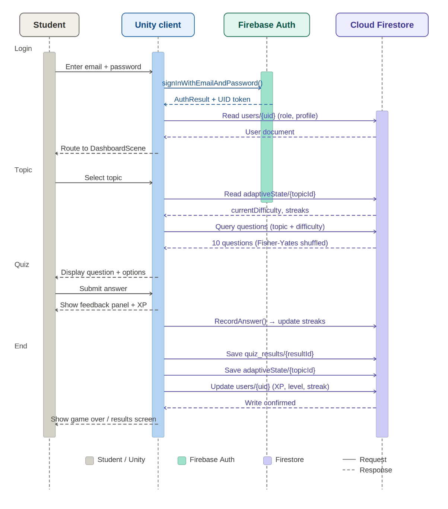
</p>

### Adaptive learning flow

<p align="center">
  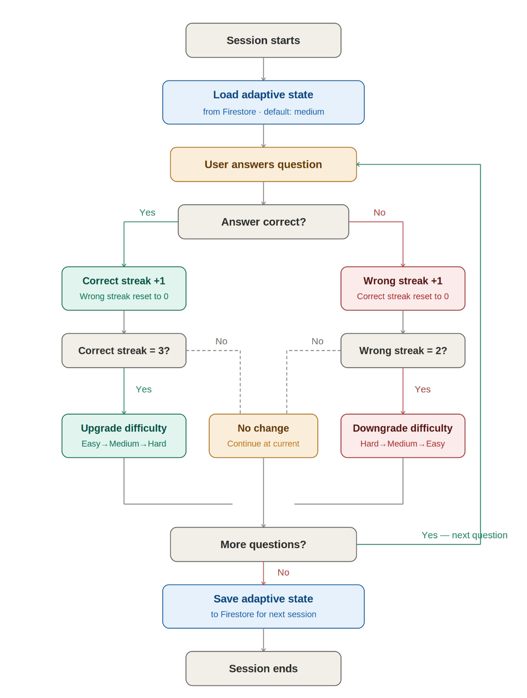
</p>

### Firestore data model

```
users/{uid}
 ├─ Username, Email, Role, Level, TotalPoints, CurrentStreak, TotalBadges, ...
 ├─ achievements/{badgeId}      unlocked, timestamp
 ├─ topicProgress/{topicId}     best score, last attempt
 ├─ adaptiveState/{topicId}     currentDifficulty, correctStreak, wrongStreak
 ├─ dailyChallenges/{date}      challengeType, progress, completed
 └─ notifications/{id}          type, message, read

quiz_results/{id}                (root collection, so the leaderboard can query across users)
questions/{id}                   topic, topicName, grade, questionText,
                                 answerA–D, correctAnswer, difficulty
```

<details>
<summary>Firestore data model diagram</summary>
<p align="center">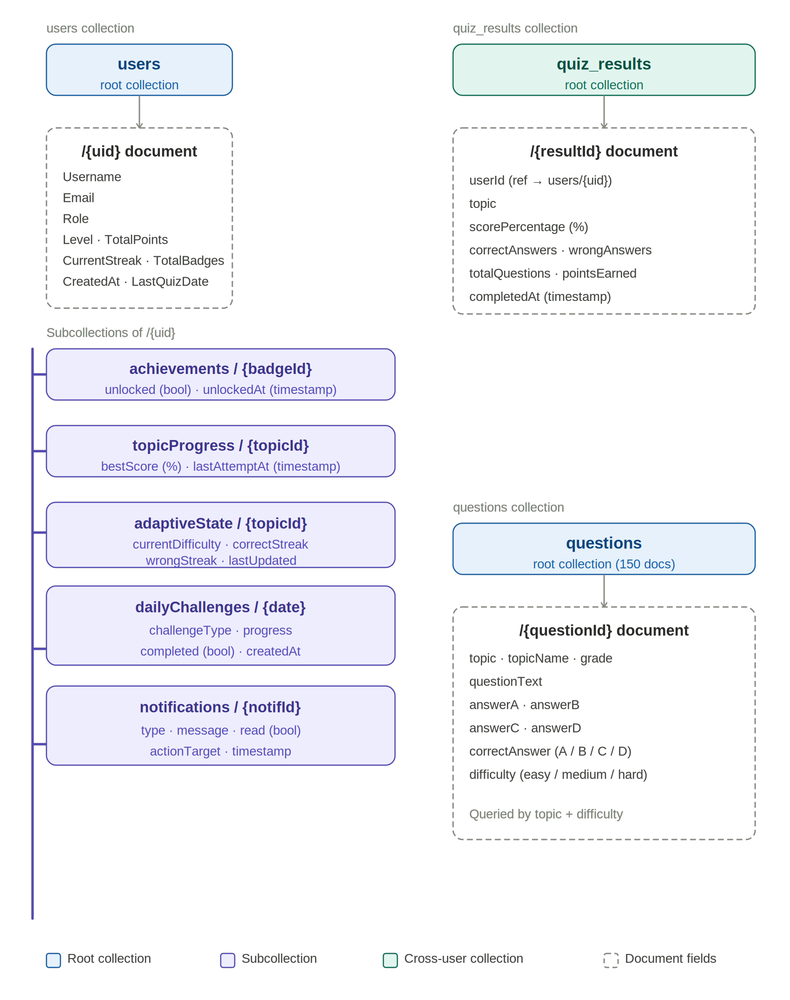</p>
</details>

---

## 📂 Project structure

```
Assets/
├── Scenes/
│   ├── MainMenuScene        Entry point, guest/login routing
│   ├── LoginScene           Firebase sign-in
│   ├── DashboardScene       Student dashboard
│   ├── TopicSelectionScene  Topic grid
│   ├── QuizScene            Quiz session
│   ├── LeaderboardScene     Rankings
│   ├── AchievementScene     Badges
│   ├── ProfileScene         Stats & logout
│   ├── NotifScene           Notifications
│   └── SettingsScene        Audio settings
├── Scripts/
│   ├── AdaptiveLearningEngine.cs   Difficulty state machine
│   ├── QuizDataManager.cs          Adaptive question loading
│   ├── QuizManager.cs              Lives, hints, XP, feedback
│   ├── DashboardManager.cs
│   ├── ProfileManager.cs
│   ├── TopicSelectionManager.cs
│   ├── Achievements/   Leaderboard/   Audio/   MainMenu/
│   └── ...
├── FirebaseManager.cs
├── LoginController.cs
└── Audio/  UI/  Firebase/  Plugins/
screenshots/                         README images
```

---

## 🚀 Getting started

### Requirements
- **Unity 6** (project version `6000.3.6f1`) with **Android Build Support** (SDK, NDK, OpenJDK)
- A **Firebase project** with Authentication (Email/Password) and Cloud Firestore enabled

### Setup
1. **Clone the repo**
   ```bash
   git clone https://github.com/MenadiDev/PlayMentor-Group-75.git
   ```
2. **Open it in Unity Hub** using the Unity 6 version above.
3. **Connect Firebase**
   - Register an Android app in your Firebase project
   - Download `google-services.json` and place it in `Assets/` (this file isn't committed)
4. **Create the Firestore composite index** on the `questions` collection: `topic` (ascending) + `difficulty` (ascending). Without it, adaptive question loading returns no questions.
5. **Add questions** to the `questions` collection using the schema above.
6. **Build for Android**: *File → Build Profiles → Android*, scripting backend **IL2CPP**, target **ARM64**, minimum API level **24 (Android 7.0)**.

> Start the app from `MainMenuScene`, since it initialises the singleton managers.

---

## 🧪 Testing

- **13 unit tests**, **5 integration tests**, **9 system tests**
- **User acceptance testing** with five Grade 10–11 students: all five completed the login → topic → quiz flow on their first try without help
- Students named **streaks and badges** as the most motivating features, and 4 of 5 said they'd use it daily for revision

---

## 🛣️ Roadmap

- [ ] Teacher and parent dashboards
- [ ] In-app question authoring for teachers
- [ ] Push notifications (streak reminders, daily challenges) with Firebase Cloud Messaging
- [ ] Offline mode with Firestore persistence
- [ ] More subjects: Physics, Chemistry, Maths, History
- [ ] Calibrated question difficulty based on real answer data
- [ ] ML-based adaptive engine
- [ ] iOS build

---

## 🛠️ Tech stack

| Area | Technology |
|---|---|
| Game engine | Unity 6 (URP, uGUI, TextMeshPro, Input System) |
| Language | C# |
| Build | IL2CPP → native ARM64 (Android) |
| Auth | Firebase Authentication |
| Database | Cloud Firestore |
| Data tooling | Python + Firebase Admin SDK (question upload & difficulty tagging) |
| Design | Figma |
| Process | Agile Scrum, 6 two-week sprints, Git Flow on GitHub |

---

## 👥 Team (Group 75)

| Member | Main contributions |
|---|---|
| **Pinnagodage Menadi** (Team Leader) | Adaptive learning engine, adaptive question loading, Firestore data model & security rules, difficulty-tagging script, UI scenes, Figma design system |
| Maraka Weerasinghe | Quiz engine: lives, hints, skip, feedback panel, game-over screen |
| Kalavila Vithana | User stats aggregation, daily streak logic, UI design |
| Kolonnagama Kolonnage | XP & level system, achievements, leaderboard & podium, daily challenges, daily quotes |
| Chakrawarthige Fernando | Login with Firebase Auth, guest mode, main menu routing, audio system |
| Ranasingha Hiranya | Dashboard and topic selection scenes, bottom navigation, scene transitions, Figma mockups |
| Mihidi Abeywickrama | Profile stats, settings, notifications, logout flow |
| Karavitalage Sandeepani | Unit, integration and system testing, UAT facilitation |

**Supervisor:** Mr. Anton Jayakody

---

<sub>Built for the PUSL2021 Computing Group Project at NSBM Green University (University of Plymouth), 2026.</sub>
